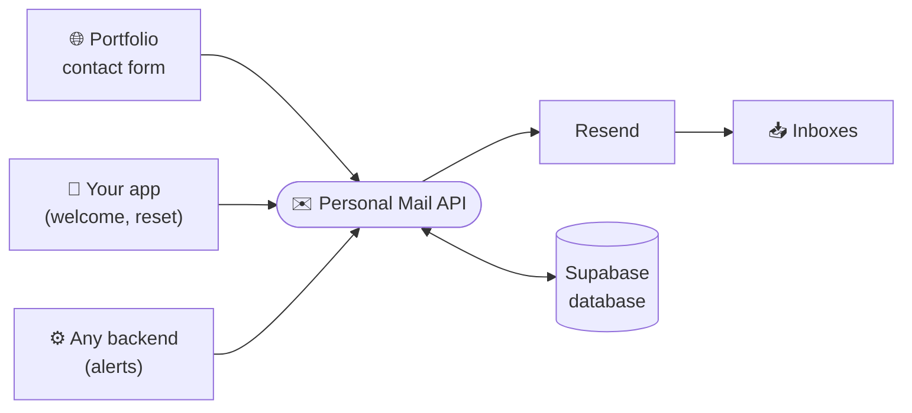
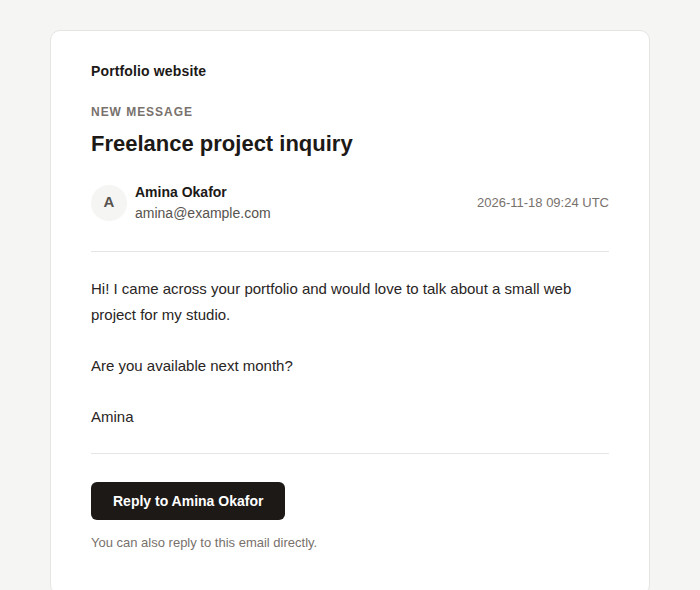
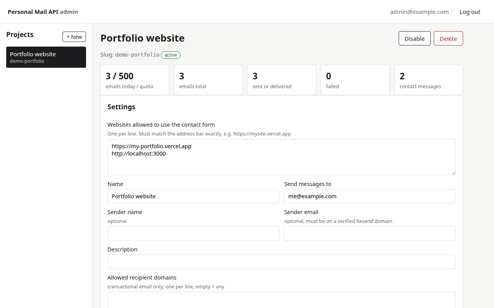

<h1 align="center">Personal Mail API</h1>

  <strong>One email service for all your websites and apps.</strong> 
  Contact forms, welcome emails, password resets and alerts, sent from a single place you own.

  <a href="docs/GUIDE.md"><strong>How to use it →</strong></a>

---

## The idea

Every project you build ends up needing email: a contact form on your
portfolio, a welcome email in your app, an alert when someone signs up.
Instead of wiring email into each one separately, you deploy **Personal Mail
API once** and let all of them use it.

Each website or app is a **project**. A project has its own settings, its
own key and its own limits, so one misbehaving site never affects the others.

## What lands in your inbox

When someone fills in your contact form, you get a clean, readable email.
Hit **Reply** and you are talking to them directly.

  

## Manage everything from the browser

Open your deployment's address and sign in. From one page you can add
projects, choose which websites may use the contact form, create keys, and
see what was sent and delivered.

  

## What you get

| | |
|---|---|
| ✉️ **Contact forms** | Messages from any of your sites, straight to your inbox. No secret keys in the browser. |
| 🚀 **App emails** | Welcome, password reset and verification emails from ready-made templates, or your own content. |
| 🔔 **Alerts to yourself** | "New sign-up", "new order", anything your app wants to tell you. |
| 📊 **Delivery tracking** | See whether each email was sent, delivered or bounced. |
| 🛡️ **Spam and abuse protection** | Allowed websites only, rate limits, daily quotas, a hidden bot trap and optional Cloudflare Turnstile. |
| 🔑 **Safe by design** | Keys are stored hashed and shown once. Passwords are strongly hashed. Visitors can never change who receives your mail. |
| 💸 **Free to run** | Works on the free plans of Render, Supabase and Resend. |

## Get started

1. **Deploy it**: Render and Supabase, about 10 minutes.
2. **Sign in** to the admin page and create a project for your website.
3. **Connect your site** with a few lines of code.

Everything is explained step by step in the **[usage guide](docs/GUIDE.md)**.

## Built with

FastAPI · PostgreSQL (Supabase) · Resend · Docker · Render

## License

[MIT](LICENSE). Free to use, change and share.
